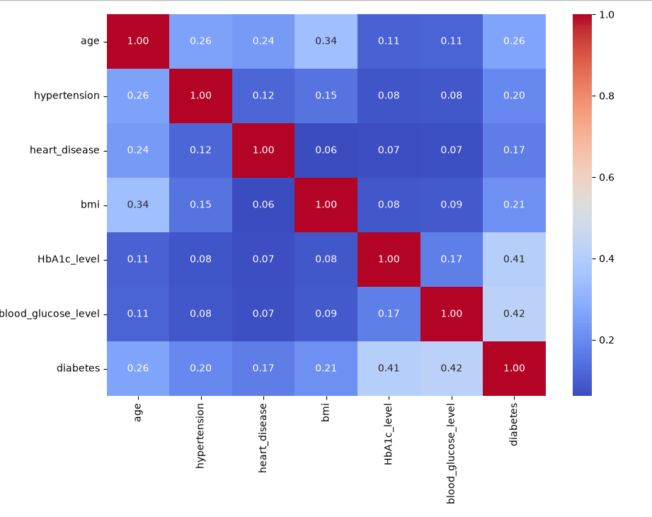
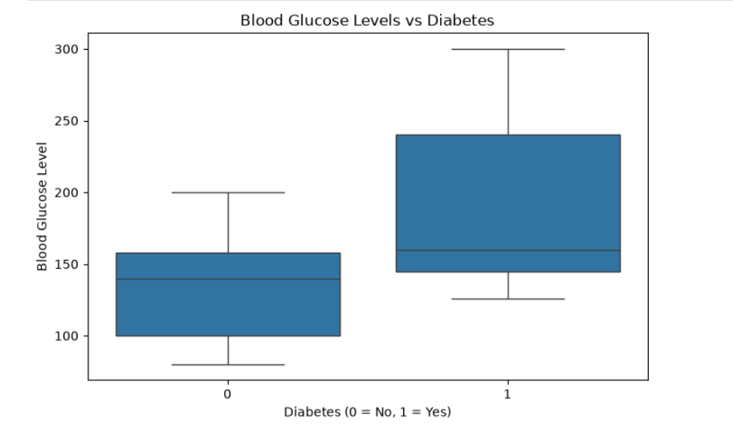
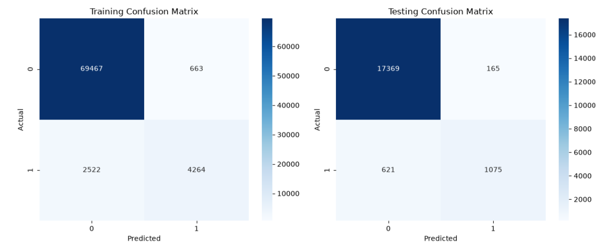
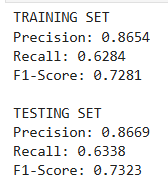

# Diabetes Likelihood Predictor

Predicts the clinical likelihood of diabetes in patients from biometric and demographic indicators using regularized Logistic Regression with standardized feature scaling (pandas, scikit-learn, seaborn).

---

## 1. Project Overview & Problem Statement

Diabetes mellitus is a chronic metabolic disorder marked by persistent hyperglycemia. Prolonged elevated blood glucose leads to severe vascular, renal, and neurological damage. Early risk stratification provides a vital clinical window for lifestyle intervention.

This project implements an end-to-end binary classification pipeline using **Logistic Regression** on 96,146 unique patient records. The model maps physiological measurements (fasting glucose, glycated hemoglobin, BMI, age, and chronic conditions) to predict patient diabetes status (`0` = Non-Diabetic, `1` = Diabetic).

* **Dataset Source:** [Kaggle Diabetes Prediction Dataset](https://www.kaggle.com/datasets/iammustafatz/diabetes-prediction-dataset)
* **Dataset Scale:** 100,000 raw observations $\rightarrow$ 96,146 cleaned observations across 9 features.
* **Prevalence / Imbalance:** 8.82% positive (Diabetic) vs. 91.18% negative (Non-Diabetic).

---

## 2. Team and Roles

**Group 53 — AI101 Mini-Project**  
*School of Artificial Intelligence and Data Engineering, IIT Ropar*

| Member | Entry No. | Primary Role | Key Responsibilities |
| :--- | :--- | :--- | :--- |
| **Manav Garg** | 2026MCB1543 | Documentation Lead | Repository documentation (`README.md`), methodology write-up, evaluation metric verification (recall, precision, F1-score), and academic reporting. |
| **Dhonnar Satyam Ramesh** | 2026AIB1031 | Execution Lead | Pipeline execution, dependency specification (`requirements.txt`), `StandardScaler` normalization, model testing, and validation. |
| **Paras Raina** | 2026EEB1389 | PPT Lead | Slide deck curation, data pre-processing and hygiene, visual asset generation (heatmaps), and presentation storytelling. |
| **Lakkireddy Thulasiram Reddy** | 2026EEB1371 | Video Lead | Technical video walkthrough, model training, parameter inspection, audio narration, and submission asset packaging. |

*All four members actively collaborated on code design, debugging, and experimental validation (verified via commit history).*

---

## 3. Project Structure

```text
AI101-Mini-Project/
├── assets/                                           # Output visualizations and performance figures
│   ├── correlation_heatmap.png                       # Feature correlation heatmap
│   ├── blood_glucose_boxplot.png                     # Blood glucose distribution box plot
│   ├── confusion_matrices.png                        # Training and testing confusion matrices
│   └── evaluation_metrics.png                        # Precision, recall, and F1 scores summary
├── Diabetes Prediction with Logistic Regression.pdf  # Project presentation deck and report
├── README.md                                         # Comprehensive project documentation
├── diabetes_prediction.ipynb                         # End-to-end pipeline (EDA, preprocessing, modeling, evaluation)
├── diabetes_prediction_dataset.csv                   # Raw dataset (100,000 observations, 9 features)
└── requirements.txt                                  # Pinned Python package dependencies
```

---

## 4. Setup

### Prerequisites

Ensure the following tools and system requirements are met before proceeding:

1. **Git:** Distributed version control system (`git --version` $\ge 2.25$).
2. **Python:** CPython runtime version **3.12 or later** (`python --version` or `python3 --version`).
3. **pip:** Python package manager (`pip --version` $\ge 21.0$).
4. **System Resources:**
   * **RAM:** Minimum 4 GB recommended (dataset loads into $\approx 100$ MB in memory).
   * **Disk Space:** At least **700 MB** free disk space for cloned repository, virtual environment, and generated artifacts.
   * **Operating System:** Tested on Windows 10/11, macOS (Intel & Apple Silicon), and Ubuntu/Debian Linux.
5. **Web Browser (Optional):** Required only if launching the interactive Jupyter Notebook interface or viewing the exported HTML report.

---

### Step 1: Clone the Repository
```bash
git clone https://github.com/Paras-Raina/AI101-Mini-Project.git
cd AI101-Mini-Project
```

### Step 2: Initialize Virtual Environment
```bash
# macOS / Linux:
python3 -m venv venv
source venv/bin/activate

# Windows (Command Prompt):
python -m venv venv
venv\Scripts\activate

# Windows (PowerShell):
python -m venv venv
venv\Scripts\Activate.ps1
```

### Step 3: Install Pinned Dependencies
```bash
python -m pip install --upgrade pip
pip install -r requirements.txt
```

---

## 5. Steps to Run

The entire pipeline is consolidated inside `diabetes_prediction.ipynb` for linear reproducibility.

### Execution Options

#### Option A: Interactive Jupyter Interface (Recommended)
1. Start the notebook server:
   ```bash
   jupyter notebook diabetes_prediction.ipynb
   ```
2. Navigate to the top menu and select **Kernel $\rightarrow$ Restart & Run All**.

#### Option B: Headless Terminal Execution & Instant Viewing
If you prefer running from the command line without opening Jupyter Notebook manually:

* **Register Virtual Environment Kernel (run once if `nbconvert` cannot find your environment):**
  ```bash
  python -m ipykernel install --user --name=venv --display-name="Python (venv)"
* **Execute In-Place (saves execution outputs directly inside `diabetes_prediction.ipynb`):**
  ```bash
  jupyter nbconvert --execute --inplace diabetes_prediction.ipynb
  ```
* **Execute to Viewable HTML Report (auto-generates an HTML file with all figures and metrics you can double-click to view in any browser):**
  ```bash
  jupyter nbconvert --to html --execute diabetes_prediction.ipynb --output report.html
  ```
  *(To open `report.html`: run `open report.html` on macOS, `start report.html` on Windows, or `xdg-open report.html` on Linux)*

### Execution Flow & Runtime
* **Cell 1–2:** Ingestion, structural inspection (`df.info()`, `df.dtypes`), and initial 5-row preview.
* **Cell 3–5:** Data cleaning (duplicate removal) and exploratory data analysis (mean, median, std dev, covariance, correlation heatmap).
* **Cell 6:** Feature selection ($X \in \mathbb{R}^{96146 \times 6}$), stratified 80/20 splitting, and zero-leakage `StandardScaler` transformation.
* **Cell 7:** `LogisticRegression(max_iter=1000)` training and coefficient extraction.
* **Cell 8–11:** Feature visualization (Box plot), accuracy computation, precision/recall/F1 diagnostics, and confusion matrix rendering.
* **Expected Runtime:** **< 15 seconds** on standard hardware (Intel i5/Apple M-series or higher).

---

## 6. Expected Output

### A. Terminal / Notebook Standard Output
```text
(100000, 9) 

<class 'pandas.DataFrame'>
RangeIndex: 100000 entries, 0 to 99999
Data columns (total 9 columns):
dtypes: float64(3), int64(4), str(2)

Missing values in each column:
gender                 0
age                    0
hypertension           0
heart_disease          0
smoking_history        0
bmi                    0
HbA1c_level            0
blood_glucose_level    0
diabetes               0
Total missing values: 0

Number of duplicate records: 3854
Dataset dimensions after cleaning: (96146, 9)

Training set shape: (76916, 6)
Testing set shape: (19230, 6)

Model intercept : -5.195

Testing Accuracy: 95.91%

TRAINING SET
Precision: 0.8654
Recall: 0.6284
F1-Score: 0.7281

TESTING SET
Precision: 0.8669
Recall: 0.6338
F1-Score: 0.7323
```

### B. Statistical Summary of Model Features
Summary statistics calculated over the 96,146 cleaned patient records:

| Feature | Data Type | Mean | Median | Std Dev | Correlation ($r$) with Target | Model Weight ($\beta_j$) |
| :--- | :--- | :---: | :---: | :---: | :---: | :---: |
| **HbA1c_level** | Continuous (`float64`) | 5.53 | 5.80 | 1.07 | **+0.4064** | **+2.4887** |
| **blood_glucose_level** | Discrete (`int64`) | 138.22 | 140.00 | 40.91 | **+0.4243** | **+1.3645** |
| **age** | Continuous (`float64`) | 41.79 | 43.00 | 22.46 | +0.2649 | **+1.0650** |
| **bmi** | Continuous (`float64`) | 27.32 | 27.32 | 6.77 | +0.2149 | **+0.5903** |
| **hypertension** | Binary (`int64`) | 0.08 | 0.00 | 0.27 | +0.1957 | **+0.2147** |
| **heart_disease** | Binary (`int64`) | 0.04 | 0.00 | 0.20 | +0.1707 | **+0.1583** |

* **Model Intercept ($\beta_0$):** `-5.195` (Reflects the low baseline prior log-odds of diabetes in the population).

### C. Performance & Error Analysis

| Evaluation Metric | Training Set ($N = 76,916$) | Testing Set ($N = 19,230$) | Interpretation |
| :--- | :---: | :---: | :--- |
| **Accuracy** | 95.86% | **95.91%** | Overall correct classification rate. |
| **Classification Error** | 4.14% | **4.09%** | Total misclassification rate ($1 - \text{Accuracy}$). |
| **Precision** | 0.8654 | **0.8669** | Out of all predicted diabetics, 86.69% truly had diabetes. |
| **Recall (Sensitivity)** | 0.6284 | **0.6338** | The model identifies 63.38% of all true diabetic patients. |
| **F1-Score** | 0.7281 | **0.7323** | Harmonic mean balancing precision and recall. |

#### Confusion Matrix Breakdown (Test Set: $N = 19,230$)
* **True Negatives (TN):** `17,369` (Correctly identified healthy patients)
* **True Positives (TP):** `1,075` (Correctly flagged diabetic patients)
* **False Positives (FP):** `165` (Type I Error: healthy patients incorrectly flagged)
* **False Negatives (FN):** `621` (Type II Error: diabetic patients missed by the model)

> **Key Clinical Finding:** While the test accuracy is high (95.91%), the baseline class imbalance (91.18% non-diabetic) means that a naive zero-rule classifier would achieve 91.18% accuracy. The clinical bottleneck lies in the **False Negatives (621 missed cases out of 1,696 actual positives)**. In real-world screening, lowering the decision threshold from 0.5 to ~0.3 or applying `class_weight='balanced'` is recommended to maximize recall.

### D. Generated Visual Artifacts

#### 1. Correlation Heatmap
  
Confirms that multicollinearity between inputs is low (highest pairwise correlation is `age` vs. `bmi` at $r = 0.34$), ensuring stable logistic regression coefficients.

#### 2. Glycemic Distribution Box Plot
  
Displays a prominent shift in blood glucose levels between non-diabetic (median $\approx 130$ mg/dL) and diabetic cohorts (median $\approx 240$ mg/dL).

#### 3. Confusion Matrices
  
Side-by-side training vs. testing heatmaps illustrating robust model generalization without overfitting.

#### 4. Classification Metrics Summary
  
Precision, recall, and harmonic F1-score breakdown across both training and holdout test partitions.

---

## 7. Links & Presentation Assets

* **Presentation Deck & Report:** [Diabetes Prediction with Logistic Regression (PDF)](./Diabetes%20Prediction%20with%20Logistic%20Regression.pdf)
* **Project Walkthrough Video:** [YouTube Video Walkthrough](https://youtu.be/B6jv8i9L7Uc)
* **Dataset Reference:** [Kaggle Dataset by Mustafa T.](https://www.kaggle.com/datasets/iammustafatz/diabetes-prediction-dataset)

---

## 8. AI-Use Disclosure

In accordance with course guidelines for the AI101 Mini-Project:

* **Tools Used:** Google Gemini 3 Flash / OpenAI ChatGPT / Anthropic Claude.
* **Scope of Assistance:**
  1. Assisting with the structure and markdown formatting of the `README.md` to ensure compliance with the 8-point TA evaluation rubric.
  2. Formatting the `requirements.txt` environment specification with compatible version bounds.
  3. Formulating the clinical error analysis section (accuracy paradox and false-negative trade-off).
  4. AI assistance in generating presentation slides and layout structure.
* **Human Verification:** All exploratory data analysis, data cleaning logic, feature scaling, model fitting, and quantitative metric calculations were run natively by Group 53 in Python using Jupyter Notebook, verified against the mathematical definitions, and presented by team members in the project video.
